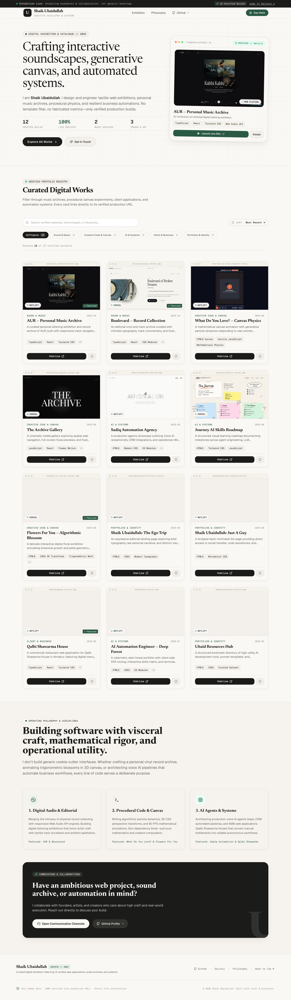

# Shaik Ubaidullah — Ultimate Website Showcase

> A curated digital exhibition bringing together 12 verified live websites, interactive sound archives, procedural canvas experiments, and automated systems engineered by **Shaik Ubaidullah**.



---

## 🌟 Overview

This is an art-directed digital atelier and project showcase. It synthesizes the warm, tactile materiality of an architect's sketchbook (Vauliys / Meng To) with the methodical clarity of an architectural catalog (CodeKart / Apple HIG).

- **100% Verified Live Builds:** Every displayed project links to an active, inspected production deployment across Netlify and Vercel.
- **Genuine High-Resolution Visual Previews:** Captured directly from live deployments using Playwright and Google Chrome.
- **Sub-Second Discovery Engine:** Instant client-side fuzzy search across titles, descriptions, and technology stacks with responsive category filters.
- **Accessible Detail Drawer:** In-situ modal inspection with architectural breakdowns and repository links.
- **Zero AI Slop:** Built with strict typography disciplines, spring physics, and zero hallucinated metrics or dummy testimonials.

---

## 🛠️ Tech Stack & Architecture

- **Core Framework:** [Vite](https://vitejs.dev/) + [React 18](https://react.dev/) + [TypeScript](https://www.typescriptlang.org/)
- **Styling & Design Tokens:** [Tailwind CSS](https://tailwindcss.com/) + Custom CSS Custom Properties (`design/design-tokens.css`)
- **Typography:** Newsreader (Editorial Serif) + Geist Sans + Geist Mono
- **Icons:** [Lucide React](https://lucide.dev/)
- **Testing & Verification:** [Playwright](https://playwright.dev/) + Node.js Custom Integrity Validators
- **Deployment:** Static edge hosting on Netlify / Vercel

---

## 📂 Folder Structure

```
website-showcase/
├── README.md                          # Project documentation
├── PROJECT_CONTEXT.md                 # Purpose, audience, and verified context
├── AGENTS.md                          # Architecture guidelines for AI agents
├── .gitignore                         # Version control exclusions
├── package.json                       # Dependencies & scripts
├── vite.config.ts                     # Bundler configuration
├── tailwind.config.js                 # Design tokens and theme extension
├── index.html                         # Semantic HTML5 entry with meta tags
├── docs/                              # Research, specifications, and QA
│   ├── DISCOVERY_INVENTORY.md         # Comprehensive audit of 17 repos & 16 deployments
│   ├── PROJECT_AUDIT.md               # Analysis of project presentation and completeness
│   ├── PRODUCT_REQUIREMENTS.md        # Core user journeys and acceptance criteria
│   ├── INFORMATION_ARCHITECTURE.md    # Site hierarchy and category taxonomy
│   ├── DESIGN_DIRECTION.md            # Visual references and art direction
│   ├── IMPLEMENTATION_PLAN.md         # Phased execution roadmap
│   ├── DEPLOYMENT_PLAN.md             # Edge hosting and CI/CD strategy
│   ├── QA_REPORT.md                   # Automated test matrix and audit results
│   ├── showcase-desktop-full.png      # Full desktop screenshot
│   └── showcase-mobile.png            # Mobile 390px screenshot
├── design/
│   ├── DESIGN.md                      # Authoritative design-system rulebook
│   └── design-tokens.css              # Reusable CSS color, typography, and motion tokens
├── public/
│   ├── favicon.svg                    # Monogram SVG favicon
│   └── projects/                      # 12 real 1280x800 screenshot previews
├── src/
│   ├── components/                    # Modular UI components
│   │   ├── AnnouncementBar.tsx        # Top status banner
│   │   ├── Navbar.tsx                 # Sticky navigation with brand wordmark
│   │   ├── HeroShowcase.tsx           # Asymmetric hero with flagship exhibit
│   │   ├── DiscoveryControls.tsx      # Search bar, category pills, sort selector
│   │   ├── ProjectCard.tsx            # Interactive project card with preview bezel
│   │   ├── ProjectModal.tsx           # Accessible details sheet
│   │   ├── AboutSection.tsx           # Philosophy and operating disciplines
│   │   ├── ContactModal.tsx           # Direct contact channels dialog
│   │   └── Footer.tsx                 # Colophon and maintenance links
│   ├── data/
│   │   ├── projects.ts                # Canonical typed TypeScript registry
│   │   └── projects.json              # Machine-readable project JSON
│   ├── styles/
│   │   └── index.css                  # Tailwind imports and grid background
│   ├── App.tsx                        # Root application logic
│   └── main.tsx                       # Entrypoint
├── tests/
│   └── showcase.spec.cjs              # Playwright automated QA test suite
└── scripts/
    ├── capture-previews.cjs           # Playwright screenshot capture script
    ├── validate-projects.cjs          # Data integrity and asset validation
    └── refresh-inventory.cjs          # Discovery script for new GitHub/Netlify repos
```

---

## 🚀 Adding New Projects (Maintenance Workflow)

To add a new project or refresh the showcase:

1. **Discover Candidates:**
   ```bash
   npm run refresh
   ```
2. **Add to Registry:**
   Edit `src/data/projects.ts` and add your project definition with its verified `productionUrl`.
3. **Capture Screenshots:**
   ```bash
   npm run capture
   ```
4. **Validate Registry:**
   ```bash
   npm run validate
   ```
5. **Build & Deploy:**
   ```bash
   npm run build
   ```

---

## 📄 License & Attribution

Designed and engineered by **Shaik Ubaidullah** (2026). All project trademarks, designs, and source code belong to their respective creators.
