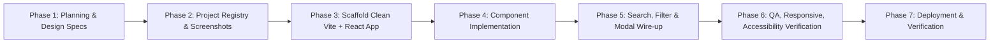

# Implementation Plan: Ultimate Website Showcase

**Architecture:** Pure Static Vite + React + TypeScript + Tailwind CSS / Semantic Tokens  
**Why this stack:**
- Lightning-fast sub-second build times.
- Zero server dependencies; 100% edge deployable to Netlify, Vercel, or GitHub Pages.
- Type-safe project registry with strict schema validation.
- Responsive, modular component architecture.

---

## 1. Ordered Implementation Phases

### Phase 1: Planning & Design Artifacts (Complete)
- Create `PROJECT_CONTEXT.md`, `DISCOVERY_INVENTORY.md`, `PROJECT_AUDIT.md`, `PRODUCT_REQUIREMENTS.md`, `INFORMATION_ARCHITECTURE.md`, `DESIGN_DIRECTION.md`.
- Produce authoritative `design/DESIGN.md` and `design/design-tokens.css`.

### Phase 2: Project Registry & Real Screenshot Capture
- Build `scripts/capture-previews.js` using Playwright and macOS Google Chrome to capture full-resolution, authentic screenshots of every verified live site into `public/projects/`.
- Build `src/data/projects.ts` (the canonical typed registry of 12 verified projects).
- Create automated validation script `scripts/validate-projects.js` to ensure zero missing fields, valid URLs, and existing preview files.

### Phase 3: Project Scaffolding
- Initialize clean Vite React TypeScript project inside `website-showcase/`.
- Configure Tailwind CSS, fonts, and link `design-tokens.css`.

### Phase 4: Component Construction
- **`AnnouncementBar`:** Tactile top banner with live status badge and verified build count.
- **`Navbar`:** Brand wordmark, category jumps, social channels, and tactile CTA.
- **`HeroShowcase`:** Split hero featuring creative developer intro, live statistics, and interactive flagship book/card.
- **`DiscoveryControls`:** Integrated search bar, category pill tabs, sort selector, and result count.
- **`ProjectCard`:** High-craft card with authentic screenshot preview, status badge, title, grounded description, verified tech pills, and direct "Open Live ↗" and "Details" actions.
- **`ProjectGrid`:** Responsive CSS grid with layout transitions and empty state.
- **`ProjectModal`:** Accessible dialog with large preview, deep technical notes, verified URL, and repository link.
- **`AboutSection`:** Personal philosophy, disciplines, and verified background.
- **`Footer`:** Copyright, maintenance workflow link, colophon.

### Phase 5: Testing & Quality Assurance
- Automated typecheck: `npm run build` / `tsc --noEmit`.
- Automated data integrity test: `node scripts/validate-projects.js`.
- Responsive layout verification at 375px, 768px, 1024px, 1440px via Playwright.
- Accessibility audit: contrast, keyboard trap, semantic landmark verification.

### Phase 6: Deployment & Handover
- Initialize Git repository and commit all clean files.
- Deploy to Netlify / Vercel using available credentials.
- Verify live production URL and document maintenance workflow.
