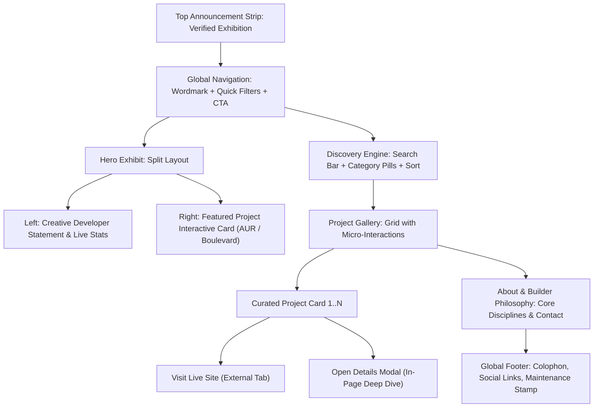

# Information Architecture & Content Strategy

**Author:** UX Strategist & Information Architect  
**Date:** 2026-10-25  

---

## 1. Page Hierarchy & Content Layout

---

## 2. Taxonomy & Categorization

To accurately reflect Shaik Ubaidullah's real catalog without shoehorning unrelated projects into generic buckets, the canonical taxonomy is:

1. **`all` (All Projects):** The complete collection of verified builds.
2. **`sound-music` (Sound & Music Archives):**
   - *AUR — Personal Music Archive*
   - *Boulevard — Personal Record Collection*
3. **`creative-code` (Creative Code & Canvas):**
   - *The Archive Gallery*
   - *What Do You Love? Canvas Animation*
   - *Flowers For You*
4. **`ai-automation` (AI Automations & Systems):**
   - *Sadiq Automation*
   - *AI Automation Engineer (Main Portfolio)*
   - *Journey AI Skills*
5. **`client-business` (Client & Local Business):**
   - *Qalbi Shawarma House*
6. **`identity-portfolios` (Personal Portfolios & Experiments):**
   - *Shaik Ubaidullah: The Ego Trip*
   - *Shaik Ubaidullah: Just A Guy*
   - *Ubaid Resources Hub*

---

## 3. Search & Filtering Behavior

- **Debounced Real-Time Search:** Search queries evaluate immediately across `title`, `description`, `category`, and `technologies`.
- **Compound Filtering:** Searching within an active category filter narrows results within that category.
- **Dynamic Project Count Badge:** Displays active matches (`Showing 6 of 12 Projects`).
- **Zero-Results State:** If no projects match, an editorial empty state renders with a "Reset Filters" action.

---

## 4. Modal / Detail View Strategy

Instead of forcing page refreshes or routing to sparse standalone pages, we implement an **in-situ modal / sheet pattern**:
- Maintains visitor browsing context in the gallery.
- Displays high-resolution screenshots, architecture notes, public repository link (if open-source), verified production URL, and live status.
- Pressing `ESC`, clicking the backdrop, or clicking the close button smoothly dismisses the modal.
